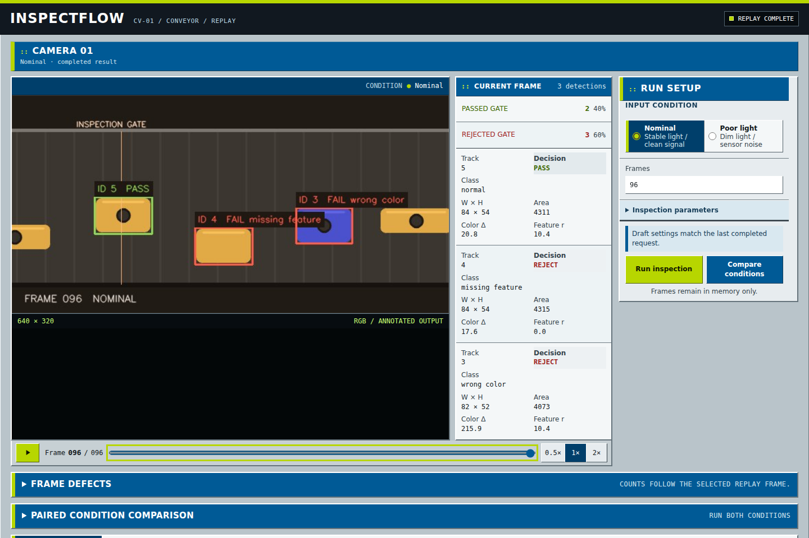
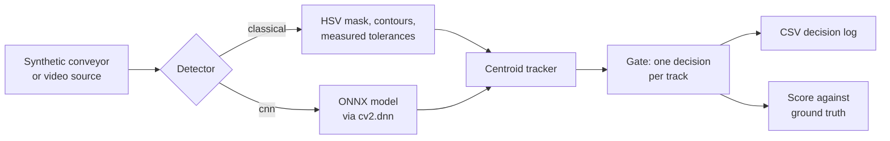

# InspectFlow

InspectFlow inspects parts on a simulated conveyor belt. It finds each part,
follows it across the frame with a tracker, and makes one pass or reject
decision when the part crosses an inspection gate. Two detectors run on the
same frames:

| Detector | How it works | Runtime |
| --- | --- | --- |
| Classical rules | HSV segmentation, contour measurement, fixed tolerances for size, color and a circular feature | OpenCV |
| CNN | 145k-parameter CenterNet-style network trained in PyTorch on synthetic frames | ONNX through OpenCV DNN, CPU only |

The scenes come from a seeded generator that records the true label of every
part. Every run is scored against that ground truth, per frame and at the gate,
and the browser dashboard shows the score next to the replay.



## Results

Twenty held-out scenes (seeds 7–26), 240 frames each. In every row, 220 parts
reach the gate: 55 good and 165 defective.

| Detector | Lighting | Gate verdict accuracy | Escapes | False rejects | Missed at gate | Detect time, 1 core |
| --- | --- | ---: | ---: | ---: | ---: | ---: |
| Classical rules | Nominal | 100% | 0 of 165 | 0 of 55 | 0 of 220 | 2.4 ms |
| Classical rules | Poor | 45.9% | 0 of 165 | 28 of 55 | 91 of 220 | 1.7 ms |
| CNN | Nominal | 100% | 0 of 165 | 0 of 55 | 0 of 220 | 21.6 ms |
| CNN | Poor | 100% | 0 of 165 | 0 of 55 | 0 of 220 | 23.4 ms |

Detect time is the median per frame on one core of an Intel i7-13700H with
OpenCV 4.14. With all 20 threads the CNN takes 7.4–8.0 ms.

- In nominal light both detectors make the right decision for every part.
- In poor light the classical rules pass no defective part, but only because
  they reject almost everything they see. The color threshold is absolute, so
  dimming moves most parts past it and good parts are rejected as wrong color.
  Parts in the darkest regions are not segmented at all and get no decision.
- The CNN decides all 220 parts correctly in poor light. Its training did not
  include the spotlight lighting used in this scene.
- The CNN costs about ten times more CPU per frame than the rules on one core.
  At 23 ms median and 29 ms at p95 it still keeps up with a 30 fps camera.
- Flat-field correction, the usual classical fix for uneven light, raised the
  rules' detection recall from 65% to 89% on validation scenes but did not
  improve defect accuracy (46% before, 43% after). The details are in
  [docs/evaluation.md](docs/evaluation.md#negative-result-flat-field-correction).

These are synthetic scenes. A perfect CNN score means it learned this
simulator, not that it would work on a real line. See
[Limitations](#limitations).

The full tables, including per-frame precision and defect-class accuracy, are
in [docs/results](docs/results). The scoring method is described in
[docs/evaluation.md](docs/evaluation.md) and the network in
[docs/model-card.md](docs/model-card.md).

## How it works



`SyntheticConveyor` draws 640 × 320 frames of rounded parts on a moving belt.
Labels are dealt in shuffled blocks of four (good, wrong size, wrong color,
missing hole). Good parts vary slightly in size and color. The poor-lighting
scenario adds a moving spotlight with flicker, sensor noise and blur, and keeps
the same parts and labels as the nominal scene.

In the classical pipeline, a part is a contour in the HSV mask above minimum
saturation and brightness. The rules check, in order, that its bounding box is
within ±18% of 80 × 50 px, that its mean color is within a Euclidean distance
of 60 from the reference, and that a dark circular hole of radius 6–14 px sits
near its center. The first failed check sets the defect label. All thresholds
can be changed from the dashboard or the API.

The CNN is a stride-8 fully convolutional network. It predicts a center heatmap
for each label plus box offset and size. It was trained on nominal frames with
random gain, light gradients, vignetting, noise and blur. The spotlight used by
the poor-lighting test scene was not part of training. Inference runs through
`cv2.dnn`, so the runtime has no PyTorch dependency. Details are in the [model
card](docs/model-card.md).

A centroid tracker predicts each track's position from its last velocity and
assigns detections greedily by distance across the whole frame, which keeps IDs
stable when detection order changes. A track gets its decision on the frame its
centroid crosses the gate at 25% of the frame width.

For scoring, per-frame detections are matched to ground truth with a min-cost
flow on IoU. Gate decisions are matched to the true part in the decision frame
and labelled as a correct pass, correct reject, wrong defect, escape (defective
part passed), false reject (good part rejected), spurious or missed.

| Module | Role |
| --- | --- |
| `generator.py` | Seeded synthetic frames and ground truth |
| `inspection.py` | Classical rule pipeline |
| `detectors.py` | CNN loading, inference and decoding |
| `tracking.py` | Centroid tracker |
| `pipeline.py` | Shared per-frame loop, gate logic, per-stage timing |
| `evaluation.py` | Frame matching and gate scoring |
| `benchmark.py`, `video.py`, `cli.py` | Command-line tools |
| `webapp.py`, `api_models.py`, `static/` | FastAPI service and browser dashboard |

## Run it

### Locally

Python 3.10 or newer is required.

```bash
python3 -m venv .venv
source .venv/bin/activate
python3 -m pip install .
inspect-flow
```

Open <http://127.0.0.1:8000>.

### With Docker

```bash
docker build -t inspect-flow .
docker run --rm -p 127.0.0.1:8000:8000 inspect-flow
```

The image runs as a non-root user and reports health from `/api/ready`.

### From the command line

```bash
# Accuracy and latency table over the 20 test scenes
inspect-flow bench
inspect-flow bench --threads 1 --json results.json

# Write a synthetic scene to a video, then inspect the video
inspect-flow render scene.mp4 --scenario poor_lighting
inspect-flow video scene.mp4 --detector cnn --output annotated.mp4 --log decisions.csv

# Inspect the first webcam
inspect-flow video 0 --detector cnn
```

`video` accepts any file, camera index or stream URL that OpenCV can open and
prints each decision as it is made. Parts must move from left to right. The
classical thresholds and the CNN are both tuned to the synthetic scenes, so
real footage needs recalibration or retraining first.

## HTTP API

Interactive documentation is served at <http://127.0.0.1:8000/docs>.

| Method and path | Purpose |
| --- | --- |
| `GET /` | Dashboard |
| `GET /api/meta` | Scenarios, detectors, defaults, limits, model hash |
| `POST /api/runs` | Generate, inspect and score a run |
| `GET /api/runs/{run_id}/frames/{index}.jpg` | Annotated frame |
| `GET /api/runs/{run_id}/inspection-log.csv` | Gate decisions with measurements and outcomes |
| `GET /api/health`, `GET /api/ready` | Liveness and readiness |

```bash
curl -sS -X POST http://127.0.0.1:8000/api/runs \
  -H 'content-type: application/json' \
  -d '{"scenario":"poor_lighting","detector":"cnn","frame_count":96}'
```

The response holds every frame's detections, the decision totals, an
`evaluation` object (frame and gate metrics) and a `timing` object (mean, p50,
p95 and maximum milliseconds for detect, track, annotate and encode).

Runs are held in memory, one is generated at a time, and older runs are evicted
by count and size. The server binds to loopback by default and has no
authentication or TLS. Do not expose it to an untrusted network.

## Retrain the CNN

```bash
python3 -m pip install -e '.[train]'
python3 training/train_detector.py --steps 4000 --device cuda
```

Training frames are generated on the fly, so there is no dataset to download.
The run above takes about 8 minutes on a laptop RTX 4050 and uses about 2 GB
of RAM with the default six data workers. The script exports the ONNX model,
scores it on the validation seeds, and writes a JSON record with the
hyperparameters, losses and SHA-256 next to the model.

## Tests and CI

```bash
python3 -m pip install -r requirements-dev.txt
pytest
npm ci && npx playwright install chromium && npm run test:e2e
```

- `pytest` covers the generator, both detectors, the tracker, gate logic,
  scoring, the API contract, the CLI and a render-then-inspect video round
  trip. CI fails below 90% line or 85% branch coverage.
- Playwright drives the dashboard in Chromium, including keyboard control,
  reflow down to 320 px and axe-core WCAG 2 A/AA checks.
- CI also runs ruff, mypy, `pip-audit`, builds and installs the wheel in a
  clean environment, and builds the Docker image and runs a CNN inspection
  inside it.

## Limitations

- Nothing here has been tested on real camera footage. Real parts have
  texture, glare, shadows and perspective that the generator does not model.
- The CNN learned a closed set of defects: four wrong sizes, three wrong
  colors and one missing hole. Other defects are untested. The classical rules
  measure tolerances, so they catch any size or color deviation, but only in
  the lighting they were tuned for.
- The classical pipeline measures parts 4–6 px larger than they are, because
  blurring before the threshold spreads part edges into the mask. The ±18%
  tolerance absorbs this at the default part size.
- One run is generated at a time and results live in memory.

## Project layout

```text
inspectflow/            package: pipeline, detectors, API, dashboard
inspectflow/models/     ONNX model and its training record
training/               CNN training script
experiments/            one-off studies, such as flat-field correction
docs/                   evaluation method, model card, benchmark results
tests/  e2e/            pytest and Playwright suites
```
