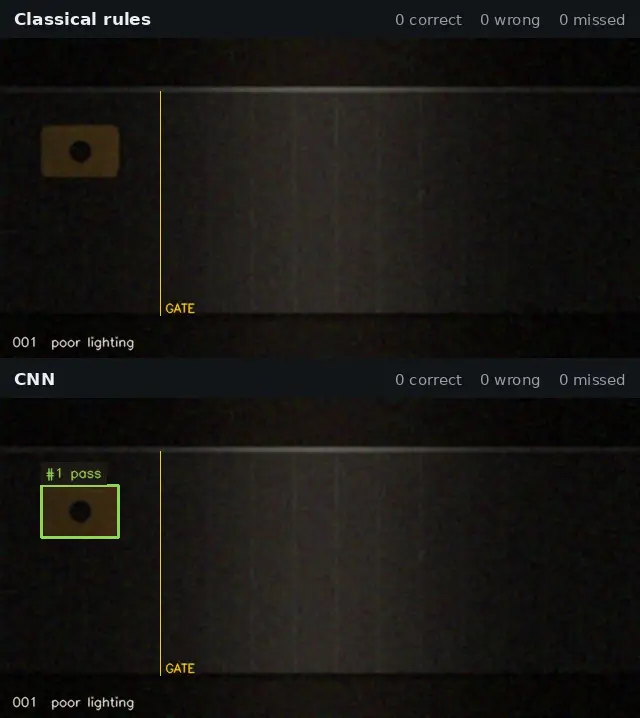
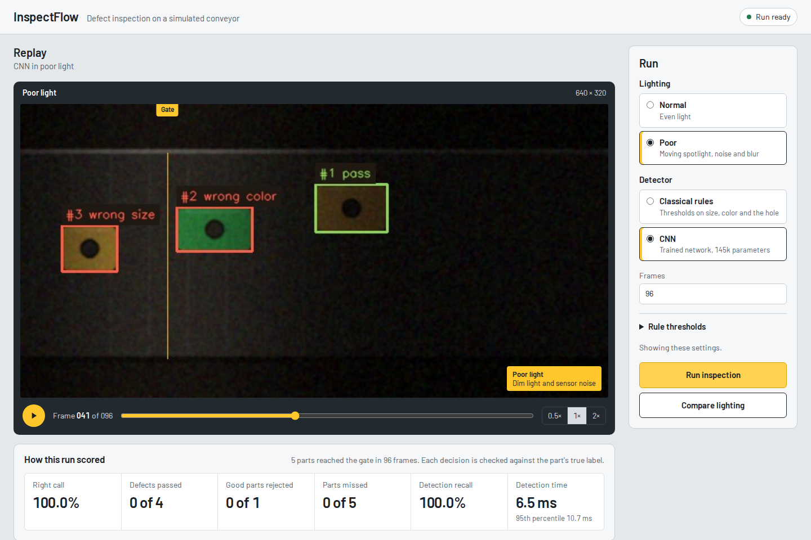

# InspectFlow

InspectFlow checks parts on a conveyor belt and decides pass or reject for each
one as it crosses a gate line. It has two detectors: hand-tuned OpenCV rules,
and a 145k-parameter CNN I trained in PyTorch and run on the CPU through ONNX.
The belt is simulated, so every decision can be checked against the part's
true label.



Same scene, same frames, poor light. The rules miss three of the seven parts
and give two of them the wrong defect. The CNN gets all seven.

## Results

Twenty test scenes, 220 parts per row (55 good, 165 defective):

| Detector | Light | Right call | Defects passed | Good parts rejected | Parts missed | ms per frame |
| --- | --- | ---: | ---: | ---: | ---: | ---: |
| Rules | Normal | 100% | 0 | 0 | 0 | 2.4 |
| Rules | Poor | 46% | 0 | 28 | 91 | 1.7 |
| CNN | Normal | 100% | 0 | 0 | 0 | 21.6 |
| CNN | Poor | 100% | 0 | 0 | 0 | 23.4 |

Time is the median on one core of an i7-13700H. With all cores the CNN takes
7–8 ms.

The rules compare each part's mean color with a fixed reference. Under the
moving spotlight most parts drift outside that tolerance, so good parts get
rejected as the wrong color, and parts in the darkest stretch of belt never
make it into the mask at all. The CNN was trained with random brightness,
gradients, vignetting, noise and blur, but never with a spotlight, and it
still calls every part. It costs about ten times the CPU, which still leaves
room for a 30 fps camera on one core.

All of this is on synthetic scenes. I haven't run the CNN on camera footage.

## Notes from building it

### The CNN looked too good

After 60 training steps it found and correctly classified every part in the
validation scenes, poor light included. I suspected leakage. The generator dealt defects in a fixed order
and moved parts at a fixed speed, so in every scene the same defect sat at the
same spot in the same frame, and a CNN can pick up absolute position from its
zero padding. I re-tested on scenes with shuffled defects and the score held,
so the network really was reading the parts. I shuffled the generator's
schedule anyway, since the old one made the test set easier than it looked.

### The textbook fix made the rules worse

To check whether the rules just needed better preprocessing, I tried
flat-field correction: estimate the light field with a large median filter and
divide it out. Detection recall went from
65% to 89%, and accuracy dropped from 46% to 43%. The belt stays out of the
part mask only because its brightness sits just under the threshold (about 60
against 65). Dividing out the light field multiplied the sensor noise by about
five, noisy belt pixels crossed the threshold, and the measured boxes grew by
8–12 px. Good parts that used to fail the color check now failed the size check.
The experiment is in `experiments/flat_field_correction.py`.

### The false positives were a labelling rule

All 65 of the CNN's first false positives on the validation scenes were parts
near the frame edge, which the ground truth skips: it only labels parts at
least 6 px inside the frame. Setting the decoder's border margin to match
removed most of them. The 19 left are parts exactly 5 px from the edge.

## Run it

```bash
python3 -m venv .venv && source .venv/bin/activate
pip install .
inspect-flow            # dashboard at http://127.0.0.1:8000
```

Or with Docker:

```bash
docker build -t inspect-flow .
docker run --rm -p 127.0.0.1:8000:8000 inspect-flow
```



The dashboard replays a run with boxes and gate decisions, scores it against
the true labels, and lets you switch lighting and detector or change the rule
thresholds. The HTTP API is documented at `/docs`.

From the command line:

```bash
inspect-flow bench                                      # the results table above
inspect-flow render scene.mp4 --scenario poor_lighting  # write a scene to video
inspect-flow video scene.mp4 --detector cnn --output annotated.mp4 --log decisions.csv
inspect-flow video 0 --detector cnn                     # webcam
```

## How it works

The generator draws 640 × 320 frames of rounded parts on a moving belt. A
part is good, the wrong size, the wrong color, or missing its center hole. A
seed fixes the parts, so both lighting conditions see the same ones.

The rules find parts with an HSV threshold and check them in order: bounding
box within 18% of 80 × 50 px, mean color within a distance of 60 of the
reference, and a dark round hole near the center. The first failed check is
the defect.

The CNN is a small CenterNet-style network. Dilated convolutions give each
cell of its stride-8 output a receptive field of about 280 px, enough to see a
whole part and judge its size. Each cell predicts a heatmap per class, a
center offset and a box size. I export it with PyTorch's TorchScript exporter
at opset 17 and run it with `cv2.dnn`, so the app itself doesn't depend on
PyTorch. Training details are in the [model card](docs/model-card.md).

A centroid tracker follows each part between frames using its last velocity.
A track gets one decision, on the frame its center crosses the gate at a
quarter of the frame width.

Scoring matches detections to the truth with a min-cost flow on box overlap,
and matches each gate decision to the part under it. Seeds 1000 and up are
for training, 100–104 for tuning, and 7–26 for the numbers above. The method
is written up in [docs/evaluation.md](docs/evaluation.md).

## Development

```bash
pip install -e '.[test,dev]'
pytest
npm ci && npx playwright install chromium && npm run test:e2e

pip install -e '.[train]'
python training/train_detector.py --device cuda    # about 8 minutes on an RTX 4050 laptop
python scripts/make_demo.py docs/images/poor-light-demo.webp   # needs ffmpeg
```

CI runs ruff, mypy, pytest with a 90% coverage floor, Playwright with axe
accessibility checks, pip-audit, a clean wheel install, and a Docker build that
runs the CNN inside the container.
